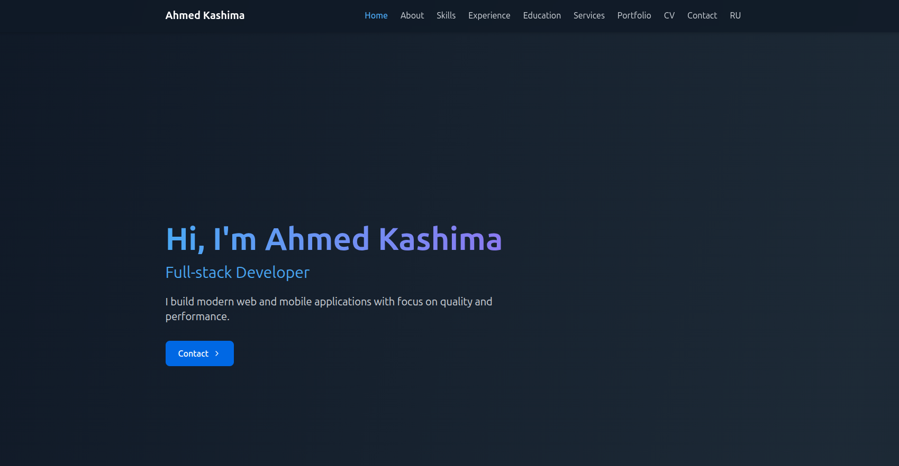
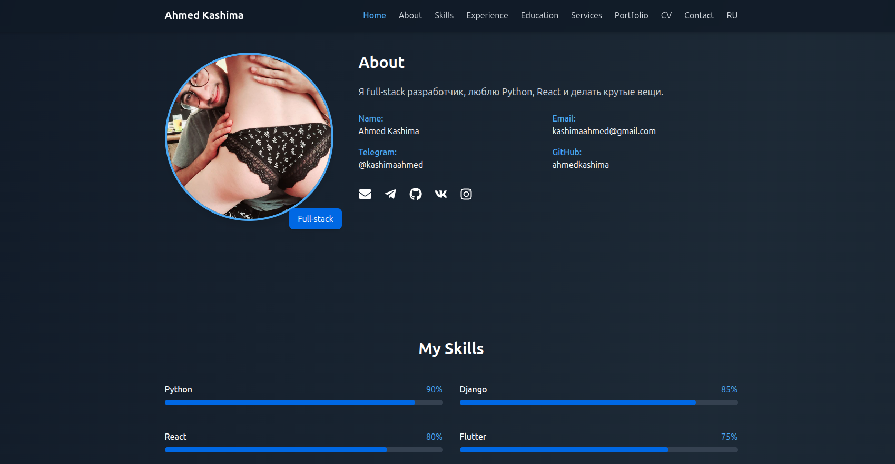

# Ahmed Kashima - Full Stack Developer Portfolio

[](https://ahmedkosh2.github.io/mysite-githpage/)
[](https://github.com/ahmedkosh2/mysite-githpage)

🌐 **Live Website**: [https://ahmedkosh2.github.io/mysite-githpage/](https://ahmedkosh2.github.io/mysite-githpage/)

<div align="center">
  
</div>

<div align="center">
  
</div>

## 🚀 Technologies Used

### Frontend
<p align="left">
  
  
  
  
</p>

### Backend & DevOps
<p align="left">
  
  
  
</p>

## ✨ Features

- **Modern UI/UX** with smooth animations
- **Responsive Design** across mobile, tablet, and desktop
- **Multi-language** support (English / Russian)
- **Interactive Elements** with Framer Motion
- **Project Showcase** and Experience timeline

---

## 🛠️ Local Development

### 1. Install Dependencies
```bash
cd deeppersonal/frontend
npm install
```

### 2. Start Development Server
```bash
npm start
```
Or from the project root:
```bash
npm start
```

---

## 🚀 Deployment to GitHub Pages

This repository is configured to deploy to GitHub Pages in two seamless ways:

### Method 1: Automatic via GitHub Actions (Recommended)
Every push to the `main` branch automatically triggers the `.github/workflows/deploy.yml` workflow, building the app and publishing it to GitHub Pages.

### Method 2: Manual deploy using `gh-pages`
From the project root:
```bash
npm run deploy
```
Or from `deeppersonal/frontend`:
```bash
npm run deploy
```

### ⚙️ GitHub Pages Configuration
1. Go to your repository **Settings** > **Pages**.
2. Under **Build and deployment**:
   - **Source**: Select **Deploy from a branch** (Branch: `gh-pages`, folder `/ (root)`) OR select **GitHub Actions**. Both are fully supported!
3. Visit the live site at: **[https://ahmedkosh2.github.io/mysite-githpage/](https://ahmedkosh2.github.io/mysite-githpage/)**

---

<div align="center">
  <a href="https://github.com/ahmedkosh2">
    
  </a> 
  <a href="mailto:kashimaahmed@gmail.com">
    
  </a>
</div>
